# Switchboard Evolution

Run and manage your coding-agent sessions (Claude Code, Codex, OpenCode) across every project, from your computer and from your phone.

Downloads, install notes and every release: **[vivi7.github.io](https://vivi7.github.io/)**.

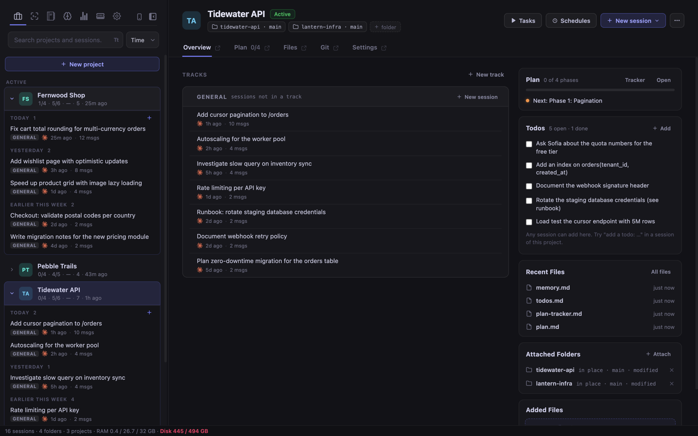

Switchboard Evolution is a desktop app (macOS, Windows, Linux) and a phone app (Android, iOS) that work together:

- **Projects** with their plans, todos, tracks and sessions in one place.
- **Sessions that survive a restart**: terminals run in herdr-core, so quitting the app leaves them running and the next start picks them up again.
- **Git built in**: a full Git Graph with its actions, staging of hunks and lines, comparing 2–4 commits step by step, and worktrees.
- **Files**: an explorer for the project and its attached folders, project-wide search and replace, and an editor.
- **A Task Manager** with the RAM each session uses, and disk space by project.
- **Your phone as a second seat**: see which session needs you, answer it, start new ones, review diffs, stage and commit. The phone talks to your computer over your local network or Tailscale, encrypted end to end, with no cloud relay. Cloudflare or ngrok tunnels are optional.

> **Independent, unofficial project.** Switchboard Evolution grows out of [Switchboard](https://github.com/doctly/switchboard) by Doctly (MIT license). It is not affiliated with or endorsed by Doctly. If you want the official app, go to [doctly/switchboard](https://github.com/doctly/switchboard).

## What it adds to Switchboard

Switchboard Evolution has all of upstream Switchboard, plus about 120 changes of its own: phone access and the mobile app, herdr-core sessions, the Git Graph with actions, staging, commit compare, worktrees, the Files explorer with search and replace, the Task Manager, and project tabs in windows of their own. The full list is in [docs/evolution-vs-switchboard.md](docs/evolution-vs-switchboard.md).

Several of these were offered upstream as pull requests, and some are merged there (see [Upstream](#upstream)).

## Screenshots

| | |
|---|---|
| 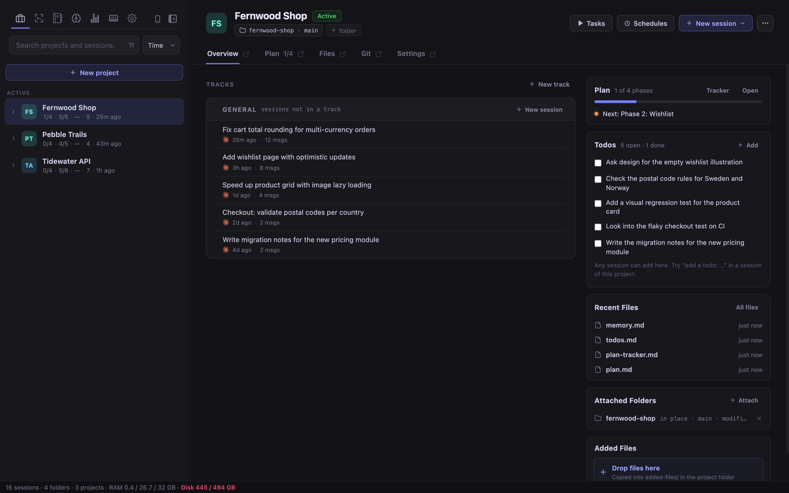<br>A project: tracks, sessions, plan, todos | 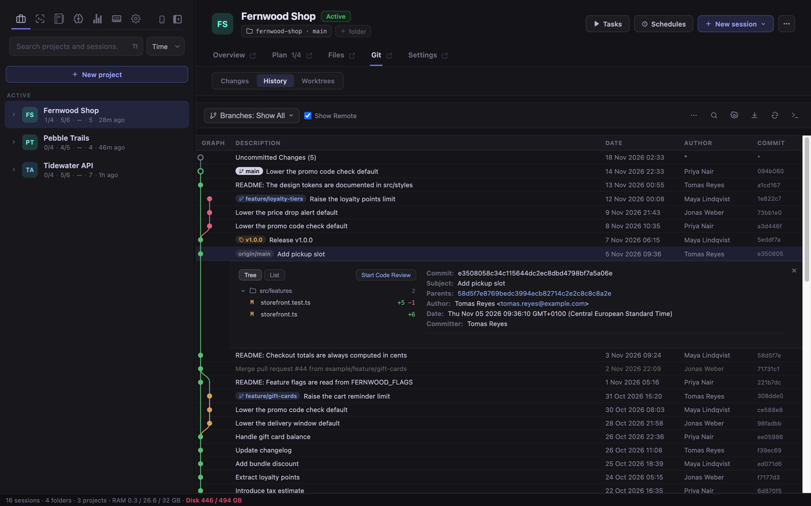<br>Git History with a commit's files |
| 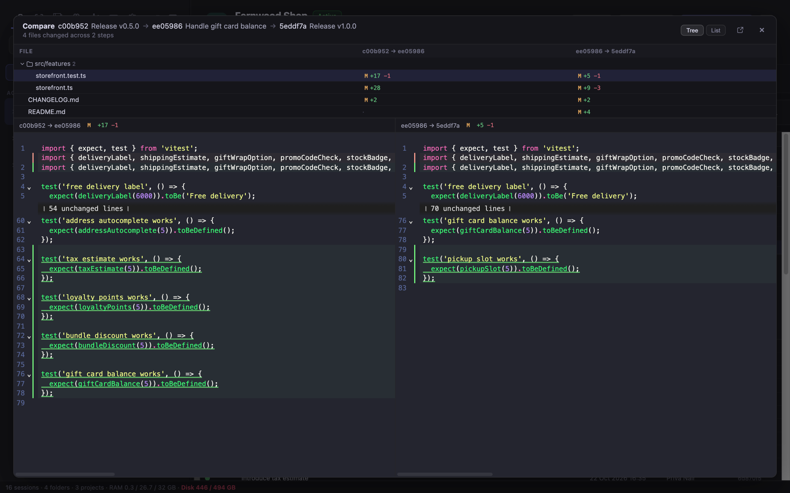<br>Compare commits step by step | 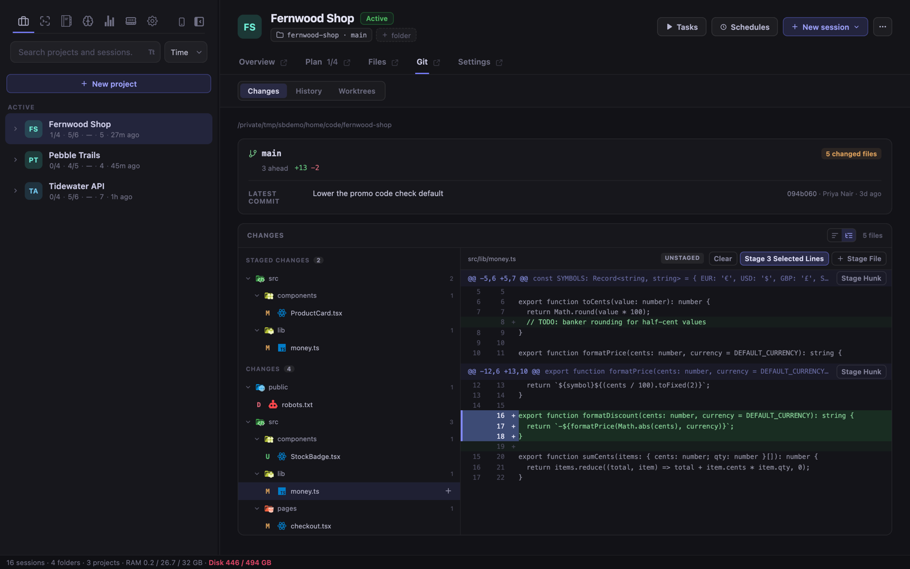<br>Stage hunks or chosen lines |
| 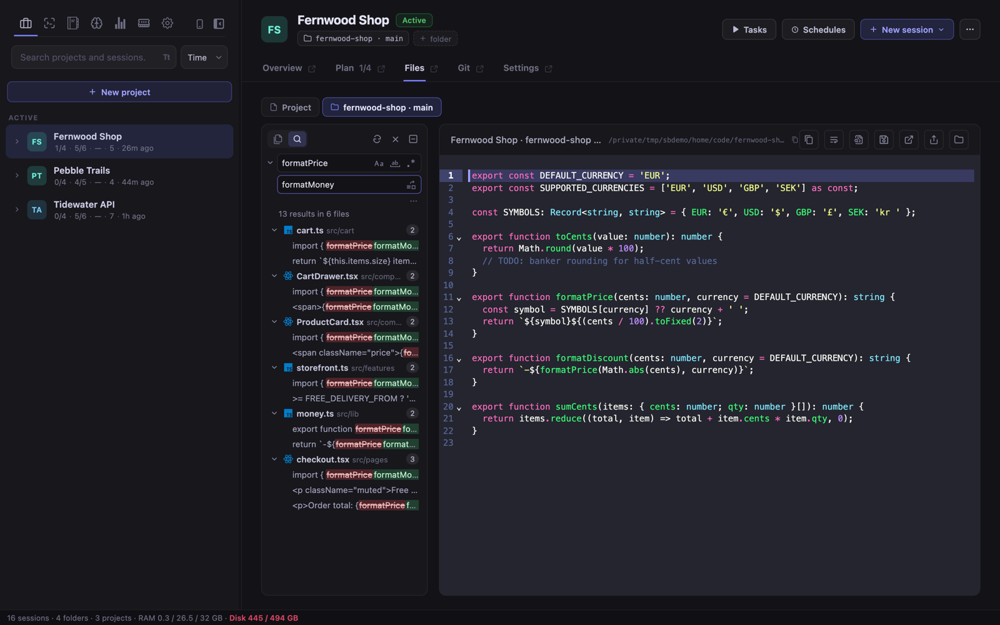<br>Search and replace across the project | 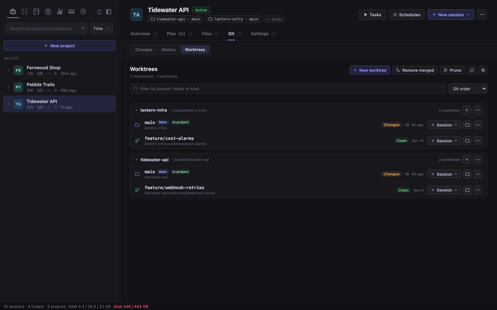<br>Worktrees of every repository |
| 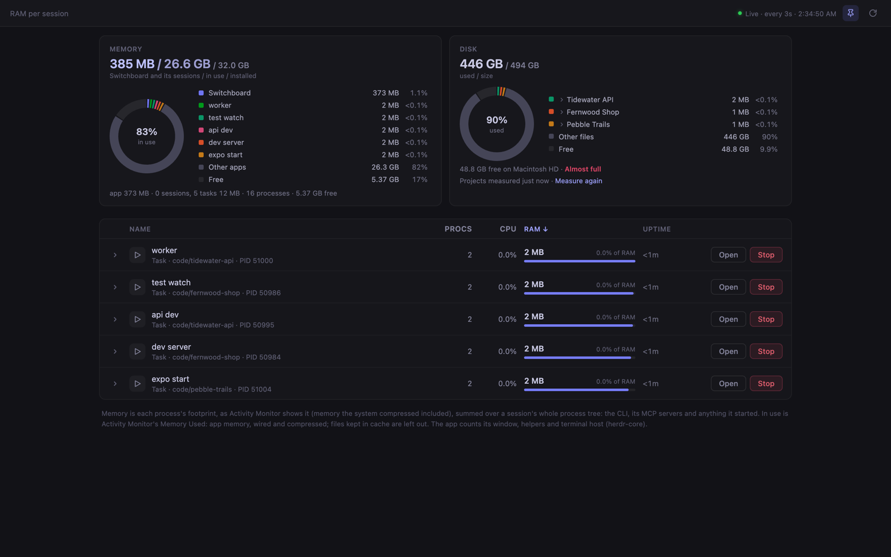<br>RAM per session, disk per project | |

On the phone:

| | | | |
|---|---|---|---|
| 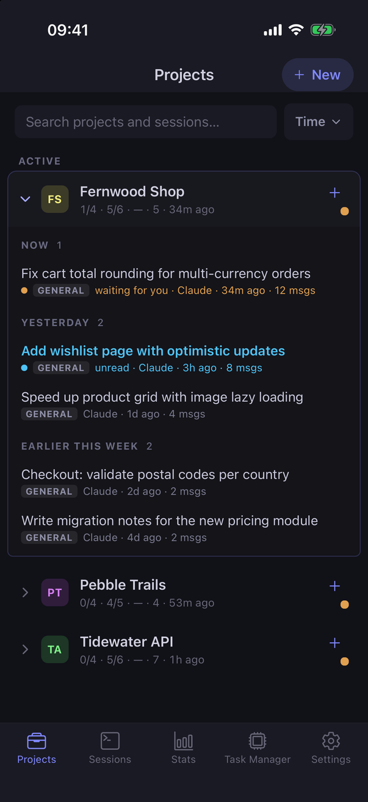<br>Projects, and who is waiting for you | 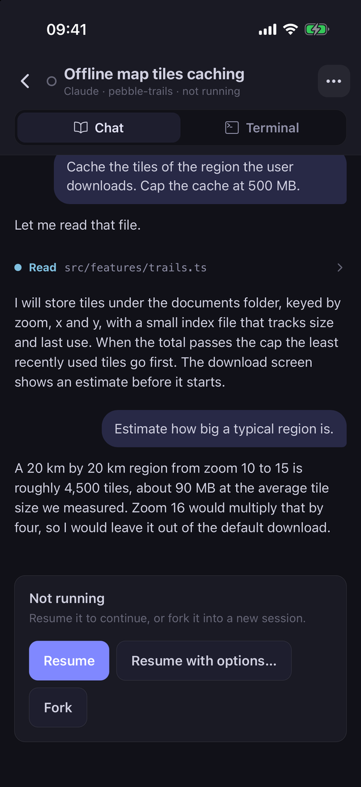<br>A session: read it and pick it up | 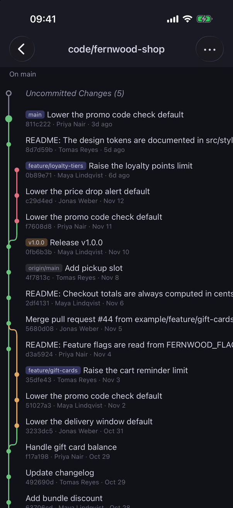<br>The Git Graph | 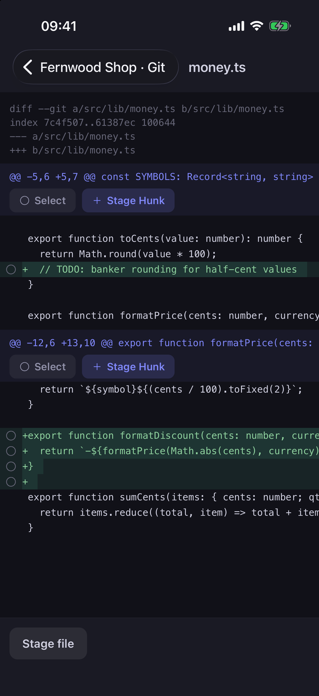<br>Review a diff, stage hunks |

All screenshots use made-up demo projects.

## Repository

```
apps/desktop     the Electron app (main process at the root of the folder, renderer in public/)
apps/mobile      the Expo app (Android and iOS), the desktop's companion
packages/shared  modules both apps use, copied into them by scripts/sync-shared.mjs
docs/            the parity list for the coming redesign, screenshots, the comparison with Switchboard
scripts/         sync-shared.mjs, upstream-sync.sh
```

## Branches

- **`master`** is Switchboard Evolution. All development happens here and both apps are built from it; it is the default branch.
- **`main`** is an exact copy of upstream [doctly/switchboard](https://github.com/doctly/switchboard) `main`, in upstream's own layout (the desktop app at the root). Nothing is committed to it by hand: the [Upstream sync](.github/workflows/upstream-sync.yml) moves it forward. Changes offered to Doctly start from it (see [Upstream](#upstream)).

## Build and run

The desktop and the phone app share one version, 1.9.1 today, tagged `v1.9.1` when it is released. A version tag builds the desktop app for macOS, Windows and Linux and the Android APK on GitHub Actions, into a draft release ([releasing](apps/mobile/docs/releasing.md)). Locally, build from source on `master`:

```bash
# desktop
cd apps/desktop
npm ci
npm run electron-dev     # a development instance with its own data folder (~/.switchboard-dev)
npm run build:mac        # or build:win, build:linux; macOS builds are ad-hoc signed, not notarized

# mobile
cd apps/mobile
npm ci
npx expo start
npm run build:apk        # an Android APK built on your computer, signed with your own key
```

The Mac and Linux builds carry herdr-core (`apps/desktop/scripts/after-pack-herdr.js`), which keeps sessions running when the app quits and lets a new version pick them up; a build that cannot fetch it stops rather than ship without it. A Mac build makes a dmg for Apple silicon (`-arm64`) and one for Intel (`-x64`): on an Apple silicon Mac install the arm64 one, as the Intel one runs under Rosetta, slower.

Turn on **Mobile app access** in the desktop app, choose **Add a device** and scan the QR code with the phone app to pair.

At the root of the repository:

```bash
npm test             # shared copies up to date, desktop tests (node --test), mobile tests (jest)
npm run typecheck    # mobile
npm run lint         # mobile
npm run sync-shared  # copy packages/shared into both apps
```

## Upstream

`apps/desktop` is derived from [doctly/switchboard](https://github.com/doctly/switchboard). This repository keeps a real link with it:

- **History.** On `master`, upstream `main` is recorded as merged into `apps/desktop`, so git knows the common base.
- **Staying in step.** Once a week the [Upstream sync](.github/workflows/upstream-sync.yml) workflow moves `main` to upstream's latest commit and merges the new upstream commits into `apps/desktop` on `master` with a subtree merge. A clean merge opens a pull request to `master`; a merge with conflicts opens an issue listing the files. To do it by hand, on `master`: `scripts/upstream-sync.sh` (it moves `main` too, and stops at the conflicts for you to resolve), then `git push origin master main`.
- **Giving back.** Changes go to Doctly as pull requests from the fork [vivi7/switchboard](https://github.com/vivi7/switchboard), since GitHub takes pull requests only from a fork. The branches start from `main` in this repository; the fork's own `main` stays identical to upstream.

  Merged upstream: [#98](https://github.com/doctly/switchboard/pull/98), [#99](https://github.com/doctly/switchboard/pull/99), [#109](https://github.com/doctly/switchboard/pull/109). Open: [#105](https://github.com/doctly/switchboard/pull/105), [#106](https://github.com/doctly/switchboard/pull/106), [#107](https://github.com/doctly/switchboard/pull/107), [#108](https://github.com/doctly/switchboard/pull/108), [#110](https://github.com/doctly/switchboard/pull/110), [#111](https://github.com/doctly/switchboard/pull/111), [#112](https://github.com/doctly/switchboard/pull/112), [#113](https://github.com/doctly/switchboard/pull/113).

To offer a change upstream, in this repository:

```bash
git remote add fork https://github.com/vivi7/switchboard.git   # once
git switch -c feat/my-change main

# the commits of master that touch the desktop app, as patches relative to apps/desktop;
# leave out Switchboard Evolution's name and icons
git format-patch --relative=apps/desktop --stdout <first>^..<last> -- apps/desktop | git am -3

git push fork feat/my-change
gh pr create -R doctly/switchboard --head vivi7:feat/my-change
```

## License

MIT. See [LICENSE](LICENSE): it keeps Doctly's copyright for the code that comes from Switchboard.
